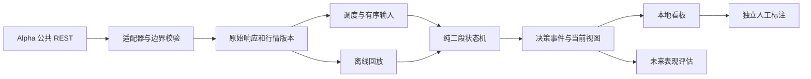

# 架构与数据契约

## 模块和依赖方向

首版使用 TypeScript 单仓库、一个采集写入进程和 SQLite。Web 入口读取持久化视图，人工标注通过同一应用写入服务提交。依赖方向由外向内，规则层只接收校验过的数据。



计划目录如下，目录粒度以真实职责为准，不拆成多个发布包：

```text
src/
  domain/               状态机、公式、规则、原因码和纯类型
  adapters/binance-alpha/ HTTP DTO、解析、身份映射、分页
  adapters/xai/          xAI Responses 传输、x_search 轮询规划与结构化解析（ADR 0003）
  adapters/telegram/     Telegram 交接目录读取与确认；账号会话由 tools/telegram-reader 的独立进程持有
  application/          采集、调度、回放、状态推进和用例
  storage/              SQLite 迁移、事务、版本与查询
  web/                  本地页面和 API，人工标注入口
  cli/                  命令入口与参数校验
test/
  fixtures/             脱敏原始响应和人工合成行情
  unit/                 公式与边界
  integration/          存储、调度、HTTP 故障和恢复
  acceptance/           实时与回放一致性及端到端场景
```

实现阶段选择受支持的 Node LTS 和 pnpm 版本，写入版本文件及 lockfile；文档不把上游 README 的最低版本当作新项目的已验证运行版本。HTTP 使用运行时已有能力，SQLite 驱动在 M0 对照版本、备份能力和事务语义后固定。运行依赖不能包含上游 bot 的账户和云数据库配置。

## 数据入口

官方公共接口无需认证，Alpha 行情与普通 Binance Spot 的交易对身份需要分别处理。[官方通用说明](https://developers.binance.com/zh-CN/docs/products/alpha/general-info)

| 用途 | GET 路径 |
| --- | --- |
| 代币发现 | `/bapi/defi/v1/public/wallet-direct/buw/wallet/cex/alpha/all/token/list` |
| 可用交易对与规则 | `/bapi/defi/v1/public/alpha-trade/get-exchange-info` |
| 历史与增量 K 线 | `/bapi/defi/v1/public/alpha-trade/klines` |

基地址 `https://www.binance.com`。K 线支持 `symbol`、`interval`、`startTime`、`endTime`，文档标明默认 500、最大 1500 条。首次采样仍需验证真实返回条数、时间边界和空响应语义。[官方 REST 规格](https://developers.binance.com/zh-CN/docs/catalog/advanced-trading-alpha-trading/api/rest-api/market-data)

身份关联使用返回的 `alphaId`，与交易对的 `baseAsset` 匹配，再核对 `quoteAsset` 和实际 `symbol`。不要把 opaque 的 `tokenId` 当作 ALPHA 编号，也不要凭展示币名构造唯一映射。字段冲突、重复映射或未知链写入隔离记录，不猜测补齐。

首版每 30 分钟保存完整代币列表和交易对快照；资产进入/退出可交易状态形成事件。全量元数据发现与 K 线采集范围分开：试运行默认 50 对，按首次见到时间、instrumentId 稳定排序选入，完整记录其余未采集者；后续扩容不删除旧样本。

## 身份与时间

| 字段 | 语义 |
| --- | --- |
| `assetId` | 本地稳定资产 ID；绑定 provider、alphaId 及可验证链上身份，映射变更另存版本 |
| `instrumentId` | provider + marketType + 原生 symbol，例如 `binance-alpha:alpha:ALPHA_175USDT` |
| `chainId`、`contractAddress` | 原始链标识和合约地址；EVM 可按已验证规则规范化，非 EVM 地址保留大小写 |
| `openAt`、`closeAt` | UTC 毫秒；规范 K 线区间为左闭右开，5m 的 closeAt = openAt + 300000 |
| `sourceCloseAt` | 上游原始收盘时间，保留以审计其含端点语义 |
| `observedAt` | 本次响应或事件实际进入系统的时刻，不改成历史收盘时间 |
| `emittedAt` | 系统持久化决策的实际时刻，不早于输入 observedAt |
| `decisionBarCloseAt` | 触发判断的 K 线边界；与 emittedAt 同时展示 |
| `availableAt` | 回放可见时间：真实采集用 observedAt，历史模拟用明确的可用性假设 |

`symbol` 只是展示/交易标识的一部分。同名资产、跨链部署和不同报价币种均不自动合并。禁止将 marketCap、FDV、流动性和成交额混作同一指标；首版核心不依赖前三者。

## 规范对象

这些是实现契约，不是已存在的 TypeScript 定义。

| 对象 | 必需内容 |
| --- | --- |
| `UniverseSnapshot` | id、provider、observedAt、responseHash、全部成员和映射版本；采集范围另记 selectionPolicyHash |
| `FetchAttempt` | requestId、接口与无敏感参数、起止时间、HTTP/业务码、条数、覆盖范围、错误分类、rawHash |
| `CandleVersion` | instrumentId、intervalMs、openAt、closeAt、OHLC、baseVolume、quoteVolume、tradeCount 可空、observedAt、rawHash、版本 ID |
| `DecisionInput` | runId、instrumentId、上次状态、已闭合行情版本 ID、显式时刻、dataQuality、policyHash |
| `DecisionEvent` | eventId、runId、setupId、前后状态、原因码、阈值与实际值、输入哈希、decisionBarCloseAt、emittedAt、isFresh |
| `ReviewLabel` | labelId、eventId、标签、reviewer 本地标识、reviewedAt、seenThroughAt、备注、supersedesId 可空 |
| `Outcome` | eventId、评估版本、起点假设、窗口、MFE/MAE/期末变化、数据覆盖、截至时间、删失状态 |

原始数值字符串原样保存；进入计算层后转换为有限数值，拒绝 NaN、Infinity、非正价格和负成交量。计算不提前四舍五入；展示格式化不改变结果。金额精度/驱动选型在 M0 用极小价格样本验证。所有百分比阈值用小数，例如 0.20 表示 20%。

## 数据有效性与分页

1. 同时校验 HTTP 状态和业务成功码；响应是 HTML、错误对象或缺失必需字段时，不当作“没有行情”。
2. 校验时间单位、5m 对齐、OHLC 高低关系、数量非负、重复项和请求区间。相同版本重复页去重；同一时间不同内容保留修订证据。
3. 仅处理已闭合 K 线。REST 查询等待收盘后至少 5 秒，并按采样确认的服务时钟偏差保守过滤；时钟异常进入 `CLOCK_UNCERTAIN`，不发新信号。
4. 分页游标根据实际返回的有效边界推进，不根据请求 limit 推断。空页、截断页、重复页和无法推进的游标都有单独状态，不能跳过未覆盖区间。
5. 缺 K 线记为 GAP。v0 不合成平盘 K 线；接口空返回不能证明该时段无交易。源数据明确给出的零量 K 线可以保存，但仍受活跃度门槛约束。
6. 1h 数据只由同一 instrument 的 12 根连续闭合 5m K 线聚合，availableAt 为所用输入的最大可知时间。任何缺口使该 1h 桶不完整。
7. 首次请求目标为近 7 天，最少 300 根连续已闭合 5m 数据才有资格运行规则。历史不足的资产保留在看板，状态为 WARMUP，不从总体中消失。

实际最早可得时间、缺口、最新闭合时刻和初次回填进度分别存储。当前列表的 listingTime 不能证明系统在历史时点已经知道该资产；集合回放只使用当时已记录的快照。

## SQLite 持久化

建议表：`universe_snapshots`、`instrument_versions`、`fetch_attempts`、`raw_responses`、`candle_versions`、`runs`、`input_journal`、`setup_events`、`setup_heads`、`review_labels`、`outcomes`、`checkpoints`。表名可调整，语义不得合并丢失。

- 单一 writer 和进程租约避免双重扫描；WAL 和有限 busy timeout。一个输入的 journal、决策事件、当前状态和检查点在同一事务提交。
- 原始响应按 SHA256 去重，以文件或 BLOB 保存；数据库记录路径/哈希。分页失败也记录 FetchAttempt。
- CandleVersion 唯一性包括 instrument、周期、开盘时刻和内容哈希，保存首次 observedAt；相同内容重复抓取不改写“首次见到”。
- eventId 根据 run、setup、输入序号、规则版本和事件种类确定；重启和重试不得重复插入同一决策。人工标注采用追加版本，不能更新机器事件。
- 已消费的闭合 K 线发生修订时，追加 `DATA_REVISED` 事件并终止受影响 setup；新 run 从可追踪数据重建。旧 run 与旧决策保持原样，不能静默改写历史信号。
- 数据库迁移先备份，并验证恢复；运行升级创建新的 run 和版本记录。降级遇到不兼容 schema 应拒绝启动，不能猜测读取。
- 初期不自动删除研究证据。磁盘不足则暂停回填并显示原因；以后增加留存策略时，固定研究数据集和审计索引必须保留。

## 调度与故障处理

初始客户端预算建议为每秒 1 次请求、并发最多 2；这不是 Binance 官方配额承诺。M0 以官方返回规则和实测中更保守的约束配置调度；所有同源调用共享限速器。

| 场景 | 处理 |
| --- | --- |
| 增量行情 | 每个 5m 收盘后调度一次；请求与持久化游标重叠至少两根，去重后推进 |
| 历史回填 | 每任务一页，默认占请求预算不超过 20%；增量有积压时让出容量 |
| 网络超时/5xx | 单次超时 10 秒，最多 2 次重试，指数退避加抖动；重试仍计预算 |
| 429 | 持久化并遵守 Retry-After；没有该头时按配置退避，暂停同源队列 |
| 403/418/地区限制 | 暂停该来源并报告具体原因，不循环重试或切代理绕过 |
| schema/身份错误 | 隔离响应，不推进对应游标，保持旧证据 |
| 断网/重启 | 恢复检查点，补齐缺口后顺序推进；迟到事件标记为历史补算 |

历史回填结束后，50 对每 5 分钟各一次行情请求约需 50/300 次请求每秒，另加元数据和重试。扩到 N 对前先用 N/300 估算增量基线，再检查真实响应时间和剩余预算，不能无限增加并发。

新鲜度门槛为 decisionBarCloseAt 距 emittedAt 不超过 10 分钟。数据质量与形态状态分开显示；缺数据暂停形态判断，不自动等同形态失败。已超过 setup 生命周期的候选可按显式时间事件到期。

## 两种回放模式

**真实采集回放 `observed-replay`**：读取原始 input_journal 的顺序，包括数据到达、时钟推进、集合变化和修订事件。使用原规则和输入版本，结果应与在线 run 一致；不能直接用今天下载的最新历史数据替代。

**历史结构模拟 `historical-simulation`**：用回填行情按闭合时间推进，并显式记录“闭合后延迟 L 毫秒可得”的假设。它只能说明形态在该假设下如何触发。若没有历史集合快照，报告标明 CURRENT_UNIVERSE_RETROSPECTIVE，并分开报告幸存者偏差风险。

两种模式的结果和统计不混合。真实回放验证实现一致性；历史模拟用于研究规则，不证明历史上实际收到过信号。

## 页面与本地访问

Web 默认只绑定 `127.0.0.1`。候选列表、事件详情、复盘标注和系统状态四个页面足够完成首版；所有页面包含加载、空结果、过期、失败和重试状态。数据分页，图表只加载所需窗口。

浏览器只访问本地应用 API，不直接调用 Binance。标注写接口校验 Origin/CSRF，名称和备注按纯文本渲染。导出附 schemaVersion、policyHash 和数据范围；CSV 避免把以公式前缀开头的备注作为可执行公式。

本地 API 至少支持健康状态、采集覆盖、候选分页、事件详情、图表窗口、标签追加和报告导出。外部网络发布或多用户访问需要新的访问控制设计，不在首版中默认开启。

## 社交来源（ADR 0003）

| 对象 | 内容 | 存储 |
| --- | --- | --- |
| 来源 | X 账号（`config/social.json`，≤20 个，一次 `x_search` 请求覆盖）与 Telegram 频道/群组（读取器白名单） | `social_sources` |
| 轮询 | 每次 xAI 请求：窗口、请求哈希、模型、提示版本、结果、用量与 `cost_in_usd_ticks`、原始响应 sha256 | `social_polls`、`raw_responses` |
| 帖子/消息 | 来源、作者、时间、原文、链接、证据等级（API_CITATION / MODEL_TEXT / TELEGRAM_READER） | `social_posts` |
| 提及 | 提取器版本、匹配方式、解析结果（UNIQUE / AMBIGUOUS / UNRESOLVED）、候选、立场、置信度 | `token_mentions` |
| 告警 | MENTION / MENTION_SETUP，run_id 固定为 `social`，payload 带当前阶段与来源 | `alerts`、`data/alerts.social.jsonl` |

社交进程（`alpha social`）持有 `social-writer` 租约，只写上述表；`watch` 读取最近提及把标的钉入采集范围（`selection.socialPinHours` / `socialMaxPinned`），并把 24 小时内的提及摘要附在 K 线告警的 `social` 字段。Telegram 账号会话、API ID/Hash 与游标只存在于独立用户 `binance-alpha-telegram` 的私有目录；交接目录 `/var/lib/binance-alpha/telegram-inbox` 以 `event-<seq>.json` 单向传递精简消息，Node 写 `ack.json` 后删除已消费文件。
